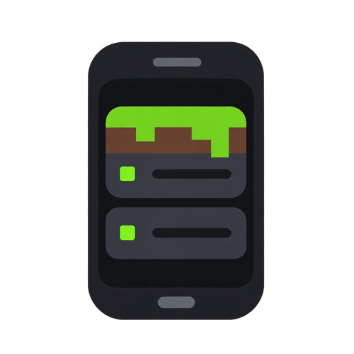

# MoboServer

Servidor de **Minecraft Bedrock** que roda **dentro do seu celular Android**. Abra o app,
escolha o mundo, ligue o servidor e mande o endereço para os amigos — sem PC, sem hospedagem
paga, sem conta em serviço nenhum.

<p align="center">
  
</p>

## Como funciona

O aplicativo carrega um servidor Minecraft Bedrock completo (escrito em Go, baseado no
[Dragonfly](https://github.com/df-mc/dragonfly)) **embutido no APK** e o executa como um
processo nativo do próprio app:

```
┌──────────────────────────── MoboServer (APK) ────────────────────────────┐
│  UI Compose  ──►  ServerController  ──►  Processo do servidor (Go)       │
│      ▲                    │                        │                     │
│      │              Estado/eventos                 │ RakNet/UDP 19132    │
│      └────────────────────┘  (JSON por stdin/out)  ▼                     │
│                                          Minecraft Bedrock dos amigos    │
└──────────────────────────────────────────────────────────────────────────┘
```

* **Sem instalar nada**: o binário do servidor viaja dentro do APK, na pasta de bibliotecas
  nativas (o único lugar em que o Android permite executar arquivos de um app).
* **Mundos reais**: o formato do mundo é o LevelDB do Bedrock, então mundos importados
  (`.mcworld`) funcionam direto e o mundo criado no app pode ser exportado/aberto no Minecraft.
* **Controle total**: ligar/desligar, console ao vivo, jogadores online, expulsar/banir,
  salvar o mundo, ajustes de jogo.
* **Segundo plano**: serviço em primeiro plano + wake lock + Wi-Fi lock, com notificação
  permanente mostrando jogadores e porta.

## Recursos da versão 1.0.8

| Recurso | Detalhe |
| --- | --- |
| Ligar/desligar servidor | Salvamento automático do mundo ao desligar |
| Importar mundo | `.mcworld` / `.zip` exportado pelo Minecraft (via seletor de arquivos) |
| Mundo novo | Gerador de terreno natural (colinas, praias, árvores, minérios) ou superflat |
| Ajustes | Nome, porta, máximo de jogadores, modo de jogo, dificuldade, distância de visão, login Xbox |
| Jogadores | Lista em tempo real, expulsar e banir (persistente por XUID); desbanir em Ajustes |
| Console | Log ao vivo, cópia do log, mensagem para todos no chat |
| Internet | Descoberta de IP público (STUN), liberação automática de porta (UPnP) e teste de acesso externo |
| Rede local | Endereço Wi-Fi na tela inicial e **anúncio automático na aba LAN** (PC, celular e console na mesma rede) |
| Otimização | Limite de memória do runtime Go conforme o heap do app, 1 worker de chunk, view distance limitada |
| Auto-teste de rede | Ao ligar, o servidor pinga a si mesmo em cada IP do aparelho e mostra na tela em quais endereços ele respondeu |
| Página de teste no PC | Enquanto o servidor roda, uma página em `http://IP:8080` confirma em qualquer navegador se o celular está acessível na rede |
| Diagnóstico | Teste do binário embutido, estado do aparelho, interfaces/rede e relatório completo (compartilhável) no console |

## Requisitos

* Android 8.0 (API 26) ou superior, **arm64** (o Minecraft Bedrock é 64 bits).
* Internet ativa (a validação de login do Xbox Live acontece ao iniciar).
* Espaço livre para os mundos.

## Download

| Arquivo | Tamanho | SHA-256 |
| --- | --- | --- |
| [`releases_apk/MoboServer-v1.0.8-android-arm64.zip`](releases_apk/MoboServer-v1.0.8-android-arm64.zip) | 18,5 MB | `9c06285632ca7f51f23628fe2e8ed4bea5f4339ba8b08aaba8c9d2f36e964e10` |

O ZIP contém `MoboServer-v1.0.8.apk`, `LEIA-ME.txt` e `LICENSE`. O APK é assinado
(`apksigner verify` roda no CI) e as próximas versões instalam por cima desta.

## Instalação

Copie o APK do ZIP para o celular e abra o arquivo — o Android vai pedir permissão para
instalar apps de fontes desconhecidas. Para conferir o download, compare o SHA-256 acima:

```bash
sha256sum MoboServer-v1.0.8-android-arm64.zip
```

## Quem consegue entrar

| Plataforma | Como entrar |
| --- | --- |
| **PC (Windows 10/11)**, **Android**, **iPhone/iPad** | *Jogar → Servidores → Adicionar servidor* com o IP e a porta. Funciona de qualquer rede, desde que a porta esteja liberada. |
| **Xbox, PlayStation, Nintendo Switch** | Esses consoles **não têm** o botão de adicionar servidor (limitação de Microsoft/Sony/Nintendo). Eles entram quando o servidor aparece na aba **LAN/Mundos**, ou seja, com o console **na mesma rede Wi-Fi** do celular — é para isso que o app se anuncia sozinho na LAN. |

O servidor é Bedrock puro: **não** aceita Minecraft Java (PC Java), a não ser através de
tradutores como o Geyser, que não vêm incluídos.

## Ninguém consegue entrar? Faça o teste em 30 segundos

O app agora responde sozinho a pergunta "o problema é o servidor ou a rede?".

1. Ligue o servidor e olhe o cartão **Acesso pela internet** na tela inicial.
   * **Auto-teste**: lista os endereços em que o servidor respondeu, visto de dentro do
     celular (por exemplo `192.168.1.106`). Se estiver vazio ou "o celular não respondeu",
     há VPN ou firewall do aparelho atrapalhando — desligue-os.
   * **Teste no PC**: mostra `http://<ip-do-celular>:8080`. Abra esse endereço no navegador
     de outro aparelho **na mesma rede**.
     * A página abre → a rede local está liberada; use `IP:19132` no Minecraft.
     * A página **não** abre → o roteador está isolando os aparelhos (isolamento de AP, rede
       de visitantes, 2,4 GHz x 5 GHz com SSIDs separados, ou PC no cabo em outra rede).
       Nenhum redirecionamento de porta resolve isso: coloque os dois aparelhos na mesma
       rede ou desative o "isolamento de clientes/AP" no painel do roteador.
2. Para o acesso **pela internet**, o cartão mostra o IP público e se a porta foi liberada.
   Sem UPnP, copie a regra sugerida e cadastre no roteador: `UDP 19132 → 192.168.1.106`.
3. Se nada funcionar, **Console → Diagnóstico**: o app monta um relatório com aparelho,
   interfaces, IPs, gateway, IP público, estado do servidor e as últimas linhas do log, e
   abre o compartilhamento do Android para você enviar.

## Uso

1. **Mundos** → crie um mundo novo ou importe o seu `.mcworld`.
2. **Ajustes** → nome do servidor, porta, jogadores, modo de jogo, dificuldade.
3. **Início** → **Ligar servidor**.
4. **Liberar porta** (UPnP) e **Testar acesso** para confirmar o acesso pela internet.
5. No Minecraft: *Jogar → Servidores → Adicionar servidor* → endereço + porta.

> Na mesma rede Wi-Fi, use o endereço local. Fora dela, o IP público com a porta liberada.
> Se o provedor usa CGNAT (IP compartilhado), o acesso externo direto não é possível.

## Estrutura do projeto

```
android/                 App Android (Kotlin + Jetpack Compose, tema escuro)
  app/src/main/java/com/moboserver/app/
    core/                Processo do servidor, estado, mundos, UPnP, STUN, serviço
    ui/                  Telas (Início, Mundos, Console, Ajustes) e tema
server/                  Servidor embutido em Go (Dragonfly + gerador de mundo)
  main.go                Flags, ciclo de vida, fonte de eventos
  control.go             Comandos (kick, ban, say, save...), banimentos, jogadores
  generator.go           Gerador de terreno natural determinístico
  selftest.go            Teste real: inicia servidor, gera chunk e faz ping RakNet
  events.go              Protocolo JSON de eventos com o app
.github/workflows/       Build do servidor + APK, self-test, ZIP e artefato
releases_apk/            ZIPs publicados pelo CI
```

### Protocolo app ↔ servidor

O app conversa com o processo do servidor por pipes, sem portas extras e sem risco de
exposição:

* **servidor → app** (`stdout`, uma linha JSON por evento): `ready`, `log`, `join`, `quit`,
  `players`, `fatal`, `stopped`.
* **app → servidor** (`stdin`, uma linha JSON por comando): `kick`, `ban`, `unban`, `say`,
  `save`, `players`, `stop`.

## Compilar

Pré-requisitos: Go 1.26+, JDK 17, Android SDK 35.

> O binário arm64 precisa de um passo extra (`scripts/patch-android-elf.py`) que aponta o
> interpretador ELF para `/system/bin/linker64` e alinha o `PT_TLS` em 64 bytes, como o Bionic
> exige; o `make server-arm64` já faz isso.

```bash
# 1. Servidor embutido (também roda o self-test)
cd server
go mod tidy
go vet ./... && go build -o /tmp/mobosrv . && /tmp/mobosrv -selftest

# 2. Binário para Android (arm64) dentro do projeto Android
mkdir -p ../android/app/src/main/jniLibs/arm64-v8a
CGO_ENABLED=0 GOOS=linux GOARCH=arm64 go build -buildmode=pie -trimpath \
  -ldflags="-s -w" -o ../android/app/src/main/jniLibs/arm64-v8a/libmobosrv.so .

# 3. APK
cd ../android && gradle assembleRelease
# saída: android/app/build/outputs/apk/release/app-release.apk
```

Ou simplesmente faça push: o workflow `.github/workflows/build-apk.yml` compila o servidor,
roda o self-test (que sobe um servidor de verdade e faz ping nele), gera o APK assinado,
coloca o ZIP em `releases_apk/` e publica o artefato.

### Assinatura

`android/keystore/moboserver-signing.p12` é uma chave **autoassinada** de desenvolvimento
(senha documentada no `build.gradle.kts`). Ela existe para que todas as versões do APK usem a
mesma assinatura e possam ser atualizadas por cima da anterior. Não é um segredo de produção
e não deve ser usada na Play Store.

## Estado dos testes

Verificado automaticamente a cada build:

* servidor Go: `go vet`, binário arm64 e **self-test real** — sobe o servidor, escuta em UDP,
  gera/recebe chunks, responde ao ping RakNet (`MCPE;...`), liga/desliga e salva o mundo;
* geração de mundo nos dois modos (`terrain`, `flat`), importação de mundo existente e
  recuperação de `level.dat` corrompido / porta ocupada;
* APK: compila em release, `apksigner verify` aprova a assinatura e o CI confirma que
  `lib/arm64-v8a/libmobosrv.so` está dentro do APK;
* o ZIP publicado em `releases_apk/` é gerado por esse mesmo build.

**Não testado em aparelho físico** durante o desenvolvimento (o ambiente de build não tem
Android): o caminho de execução do binário, o serviço em primeiro plano, o UPnP de roteadores
reais e o layout em telas pequenas foram escritos seguindo as APIs documentadas, mas a
validação final é a primeira execução no seu celular. Se algo falhar, o console do app mostra
a mensagem de erro do servidor.

## Changelog

### 1.0.8

* **UPnP funcionando de verdade no Android 9+**: o app falava `http://` com o roteador, e o
  Android bloqueia tráfego em texto claro por padrão — a descoberta terminava sem serviços e
  a tela dizia "não encontrei um roteador com UPnP" mesmo em roteadores compatíveis. Agora o
  manifesto permite esse tráfego (a conversa é só com o gateway da rede local) e a mensagem
  mostra o motivo real da falha.
* **Auto-teste de rede**: ao ficar online, o servidor faz um ping RakNet em cada IPv4 do
  aparelho e emite o resultado para o app (tela inicial e log). Isso separa "o servidor não
  está escutando" de "a rede não entrega o pacote" — a dúvida número 1 de quem não conecta.
* **Página de teste no PC**: durante a sessão o app serve `http://<ip>:8080` com o estado do
  servidor. Se o navegador de outro aparelho abre a página, a rede local está liberada.
* **UPnP mais robusto**: o socket SSDP agora é preso à interface do Wi-Fi (em celular com
  dados móveis + Wi-Fi o roteador não era encontrado), com 3 rodadas de `M-SEARCH` e fallback
  no descritor do gateway (`:5000/rootDesc.xml`).
* **Logs**: botão **Diagnóstico** no console compartilha aparelho, interfaces, IPs, gateway,
  IP público, estado do servidor e as últimas 120 linhas do `server.log`.
* O self-test do CI também valida o ping **pelo IP da interface** (não só pelo loopback).

### 1.0.6

* **Detecção de CGNAT**: quando o IP público está em `100.64/10`, o app avisa que redirecionar a
  porta não resolve e sugere Tailscale/ZeroTier.
* **Passo a passo de port forwarding**: se o roteador não tem UPnP, a tela mostra a regra exata
  (UDP, porta, IP do celular) com botão de copiar.
* **LAN em redes 100.64/10**: hotspots e redes com CGNAT também são anunciados na aba LAN
  (antes eram descartados por não serem 192.168/10/172.16).
* Aviso claro quando o celular está sem Wi-Fi (dados móveis não recebem conexões de fora).

### 1.0.5

* **DNS**: o Android não tem `/etc/resolv.conf` — o resolvedor puro do Go caía em `[::1]:53` e
  nenhum nome resolvia, o que derrubava o login do Xbox Live e, junto, a abertura do listener
  (`dial tcp: lookup client.discovery.minecraft-services.net ... connection refused`). O app
  agora lê os servidores DNS da rede (`LinkProperties`) e os repassa ao processo com `-dns`.
* **Modo aberto**: se o serviço de login da Microsoft continuar inacessível (rede bloqueada,
  DNS do provedor, proxy), o servidor sobe **sem verificação de conta** em vez de não subir, com
  aviso na tela inicial e no console.
* Mensagem de timeout de inicialização mais clara (aponta o Console).

### 1.0.4

* **Correção do aborto do Bionic**: o linker do Android exige `PT_TLS` alinhado em 64 bytes no
  ARM64 (`executable's TLS segment is underaligned: alignment is 8, needs to be at least 64 for
  ARM64 Bionic`, SIGABRT/código 134). O linker do Go grava 8. Agora o build ajusta o alinhamento
  (o segmento nem é lido: sem cgo o runtime do Go não usa TLS).
* O CI valida interp, alinhamento de TLS, ausência de `DT_NEEDED` e PIE aarch64 antes de empacotar.

### 1.0.3

* **Correção do "Cannot run program ... error=2"**: o binário do servidor era um PIE compilado
  para Linux, que aponta para `/lib/ld-linux-aarch64.so.1` (loader do glibc) — esse arquivo não
  existe no Android, então o `execve` falhava com ENOENT mesmo com o binário presente. Agora o
  `PT_INTERP` é reescrito para `/system/bin/linker64` e o CI valida o ELF antes de empacotar.
* Mensagem de erro de execução mais clara, apontando o Diagnóstico.

### 1.0.2

* **Correção do crash ao abrir**: a tela inicial carregava `@mipmap/ic_launcher` como bitmap,
  mas em Android 8+ esse recurso é um *adaptive icon* (XML), e o Compose não consegue
  decodificá-lo — o app abria e fechava na hora. Agora usa um PNG dedicado.
* **Relatório de falhas**: se o app cair, a próxima abertura mostra o erro com "Copiar" e
  "Compartilhar" (antes fechava em silêncio).
* **Anúncio na LAN**: o servidor se anuncia como um mundo aberto para LAN, então PC, celular
  e consoles na mesma rede Wi-Fi encontram o mundo sem digitar IP.
* **Início/parada fora da thread principal**: evita travar a interface em aparelhos lentos.
* **Diagnóstico nos Ajustes**: testa o binário embutido (`mobosrv -version`) e mostra ABI,
  caminho e espaço livre.

### 1.0.1

* Correção do envio do comando `stop` (salvar o mundo ao desligar).
* Lista de banidos com "Desbanir" nos Ajustes.

## Limitações conhecidas

* Provedores com CGNAT impedem acesso externo direto.
* UPnP depende do roteador; sem ele, é preciso liberar a porta manualmente.
* O consumo de CPU/RAM é do aparelho — celulares modestos suportam poucos jogadores.
* Não há tunelamento embutido (por exemplo playit.gg) nesta versão.
* Apenas `arm64-v8a` (não há build para armeabi-v7a/x86).

## Licença

MIT — veja [LICENSE](LICENSE). Servidor baseado em Dragonfly (MIT).
Minecraft é marca da Mojang/Microsoft; este projeto não é afiliado à Mojang.
